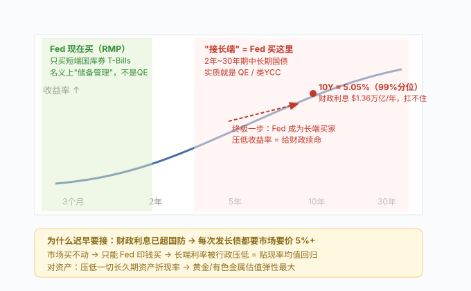
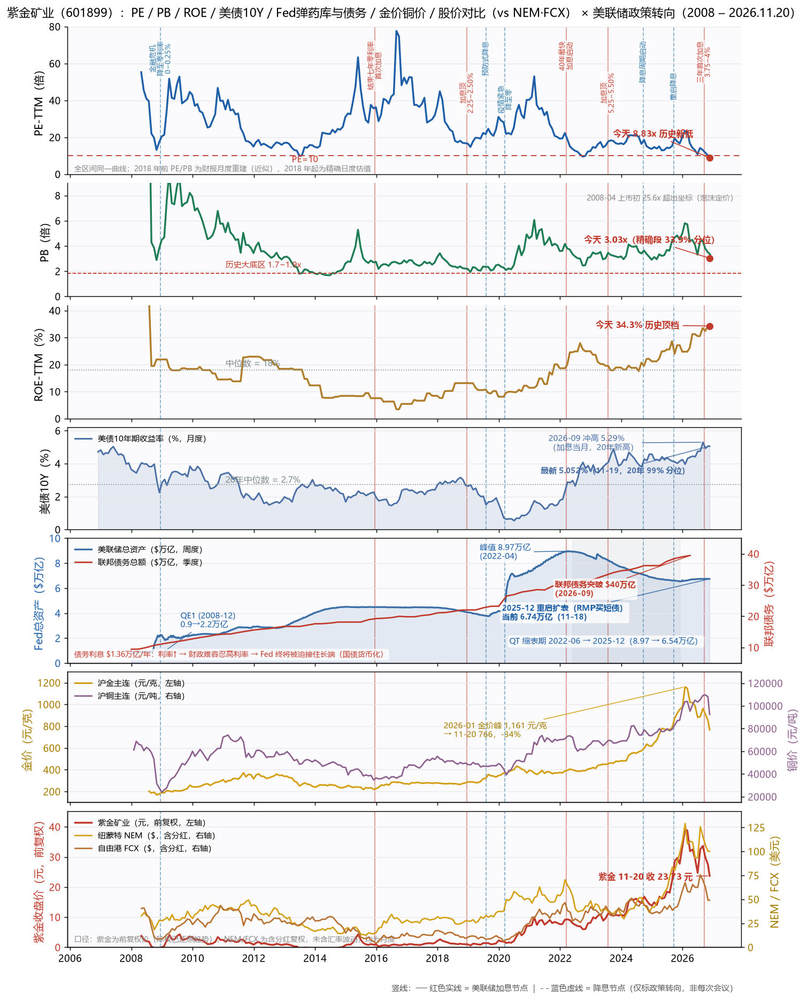

## 美债化债的终局，黄金与有色金属的重估：以紫金矿业为例

> 写于 2026 年 11 月 20 日。数据口径均标注在文中，估值数据截至 2026-11-20 收盘。  
> 本文是研究笔记而非投资建议，所有"必然"都应理解为"约束条件下的大概率"，而非时点承诺。

---

## 一、美国政府到底有没有钱

先看财政部 10 月 16 日刚公布的 2026 财年决算（2025-10 ~ 2026-09）：

| 项目      | 2026财年        | 备注                     |
| ------- | ------------- | ---------------------- |
| 财政收入    | 5.4 万亿美元      | 创纪录，同比仅 +3%            |
| 财政支出    | 7.4 万亿美元      | 创纪录，同比 +6%             |
| **赤字**  | **1.99 万亿美元** | 历史第三高，仅次于 2020、2021 财年 |
| 债务利息（毛） | 1.36 万亿美元     | 已超过国防，仅次于社保与医保         |
| 债务存量    | 突破 40 万亿美元    | 2026 年 9 月刚刚破的里程碑      |

三个数字值得放大看：

**其一，赤字占收入的比重，十年间从 18% 涨到 37%。** 2016 财年赤字约 5,870 亿，相当于当年收入的 18%；今天接近 2 万亿，占 37%。这不是周期波动，是结构失衡——支出增速长期跑赢收入增速一倍。

**其二，这是连续第 25 个赤字财年。** 美国上一次财政盈余停留在 2001 年。更麻烦的是连"开源"的备用方案也被堵上了：最高法院否决了上届政府加征的大部分关税，触发了年内 1,450 亿美元的关税退款，净关税收入反而少了 220 亿。

**其三，利息是个会自我加速的数字。** CBO 的基线预测是：到 2036 财年，赤字升至 3.1 万亿、净利息升至 2.1 万亿、公众持有债务占 GDP 从 101% 升至 120%。而这一切的预测假设，还是收益率不再恶化。

而就在决算公布三周后，2026 年 11 月 3 日的中期选举以"蓝潮"收场——民主党重夺参众两院。这份报表未来两年的政治环境，就此被盖章锁定（详见第三节的推演）。

于是问题收敛为一个：**这 2 万亿的缺口，钱从哪里来？**

## 二、资金管道：四层结构，一层比一层"水"

把美国政府的资金来源拆开，是一个四层漏斗：

1. **税收（5.4 万亿）**——覆盖 73%。但收入增速 3% vs 支出增速 6%，缺口每年自然扩大，这一层指望不上。
2. **发债（1.99 万亿）**——目前的主渠道。买家是养老金、共同基金、外国主权资金（约三成）、货币基金和稳定币（正在狂买短债）。问题是：10 年期美债收益率 5.07%（20 年约 99% 分位，2026 年 9 月一度冲到 5.29%）说明**这个渠道的价格已经高到买家开始挑三拣四**。
3. **财政部自己腾挪**——多发短债绕开长端定价、调节 TGA 账户余额（目前约 0.9 万亿）。这是 2023 年"量化紧缩对冲"的老剧本，能续命，不能治病。
4. **美联储——最后的买家**。这不是选择题，是被迫的接盘侠。

第四层需要展开，因为它是全文的枢纽。

## 三、第一性原理：为什么只能稀释，不能节流

把所有选项摆上桌面，用排除法走一遍。前提只有一个公理：**美国是以本币计价债务的主权发行人，它永远不会"还不起"，只会"不值钱"。** 希腊会破产，因为它借的是欧元；日本不会，因为它借的是日元。美国同理。所以"违约"这个选项从一开始就不存在——对自己印的货币违约毫无意义，真正的问题是债务的**实际购买力**。

### 选项 A：节流 —— 不可能

看支出结构就明白了。2026 财年的大头：社会保障 1.67 万亿（同比 +864 亿）、医保 Medicare + Medicaid 合计约 1.07 万亿（+760 亿）、债务净利息 1.05 万亿（+814 亿）。**这三项都是法定强制性支出**，不随经济周期收缩，不受年度拨款约束，动它们等于修改法律，修改法律等于政治自杀——选民结构决定了没有总统能砍社保。

剩下的可裁量部分呢？国防支出今年还跳增了 480 亿，且政府正在要求国防再增加近 5,000 亿预算。政治现实是：**议员们一边公开忧虑赤字，一边持续减税、放任支出飙升。** 节流在数学上可行，在政治上为零。

### 选项 B：开源 —— 不可能

加税？政治不可行，方向反了——本届和历届的趋势都是减税。关税？被最高法院否了大半，还倒贴了退款。抛售资产、变卖黄金储备？杯水车薪，且象征意义极差。开源这条路，比节流还窄。

### 中期选举把 A、B 两扇门焊死了

如果以上还只是"长期政治趋势"的推断，那么 2026 年 11 月 3 日的中期选举把它变成了铁案。

民主党掀起"蓝潮"，一举夺回参众两院：参议院 54:44（净增 7 席，得州 1988 年以来首次翻蓝、堪萨斯 1932 年以来首次），众议院预计超过 245 席。败因清晰得近乎直白——关税战推高物价、伊朗战事推高油价，选民用生活成本投了票：60% 不认可执政表现，75% 对国家方向"不满或愤怒"，70% 希望国会制衡总统。

这个结果对 A、B 两条路是**双向锁死**：

- **节流（A）彻底出局。** 钱袋子的宪法权力在国会，而新国会多数党的竞选纲领是"保护并扩大社保和医保"——它正是靠选民的账单愤怒上台的。让一个以"物价太高"为议题胜利的政党去削减民生支出，等于让戒烟公司卖烟。更何况，即便削减法案在国会通过，还有总统否决权横在中间——特朗普已公开表示将更频繁使用否决权，而民主党两院席位均不足三分之二，无法反制。
- **开源（B）同样出局。** 民主党想加税？法案过得了国会，过不了总统的钢笔。共和党想减税续命？过不了民主党众议院。关税开源呢？它刚刚被选民亲手否决——本届政府输掉选举的直接原因就是关税战推高物价，况且最高法院早已裁掉大部分关税授权。**一套被法院否决、又被选民否决的开源工具，不可能在 2028 年前复活。**

于是"分裂国会 × 分裂政府"产生了一个反直觉的均衡：**两党在任何减赤方案上都无法达成一致，但在"什么都不削减"上是天然的默认同盟**——因为法定支出不需要任何人投票，它按公式自动增长。未来两年，赤字将进入自动巡航模式：没有削减的立法可能，没有开源的立法可能，只有按部就班膨胀的强制性支出，和按市场利率滚动的利息。

还有两个容易被忽略的推论：

**其一，这次选举本身证明了"通胀是政治毒药"。** 任何一届政府放任生活成本上涨，都会在 18 个月内被选民惩罚。这意味着未来所有政治力量面对物价问题的本能反应都是补贴、转移支付和价格干预，而不是紧缩——财政膨胀的压力在政治上获得了跨党派的强化。

**其二，对美联储的政治施压只会加码。** 白宫在输掉国会后，更需要在 2028 年前交出经济答卷；国会民主党人同样有动力推动宽松。"维持高利率以压制通胀"的立场，将同时承受来自行政和立法两个方向的挤压。利率政策的天平，进一步向财政端倾斜。

### 选项 C：违约/重组 —— 不存在

如前所述，本币债务的"违约"是伪命题。真实的违约形式只有一种：**通过通胀让持有人蒙受实际损失**——而这恰恰是选项 D 的一部分。

### 选项 D：稀释 —— 唯一解，且已经开始

所以逻辑推演到这里只剩一条路：**让债务的 分子（名义债务）涨得慢一点，让分母（名义 GDP / 货币购买力的反面）涨得快一点。** 用大白话讲：印钱，通胀，温水煮债主。

这不是阴谋论，是正在发生的会计事实：

- **美联储总资产 6.74 万亿美元（2026-11-18），同比已净增约 1,780 亿**——QT 名义上结束了，资产负债表实际已转为扩张；
- 持有的**国库券一年暴增约 3,850 亿**，MBS 到期回笼的资金不再缩表，而是转买短债（11 月 14 日刚公布 140 亿美元短债购买用于 MBS 再投资）；
- 2025 年 12 月启动的储备管理购债（RMP）虽因钱荒短暂暂停，但已公告 12 月中旬恢复。

值得注意的是，这套操作在名义上**不叫 QE**——官方话术是"维持充足准备金水平的技术性操作"。但买的是国债、用的是新创造的准备金，会计上与 QE 无异。这就是现代货币稀释的标准形态：**不承认的量化宽松。**

### 为什么不需要急着"接长端"

有人会问：Fed 现在只买短债，长端 5%+ 的高收益率不是还挂着吗？答案是：财政部还有中间手段——**金融抑制**。

- 改革 SLR（补充杠杆率）规则，让商业银行有资本空间吞下国债；
- 给稳定币立法（GENIUS Act 框架），让加密行业的储备需求成为短债的边际买家；
- 用短债滚动代替长债发行，压低即期利息成本；
- 让通胀保持在 3% 上下——名义 GDP 增长 5-6%，债务实际利率为负，债主被慢慢稀释。

这是 1945-1980 年美国处理二战债务的原版剧本，也是日本过去三十年的实操。**名义上没有 QE、没有零利率，实际上收益率被长期压在名义增长之下。**

但金融抑制有一个数学上限：**利息支出本身。** 1.36 万亿的年利息在滚动再融资下只会惯性上行——只要 10 年期利率维持在 5% 附近，每一年都有更多低息旧债到期、换成高息新债。按当前斜率推算，两年内利息将超过社会保障成为第一大支出项。**到了那一步，财政对高利率的容忍度会触及数学红线，Fed 将被迫从"买短债的技术操作"升级为"接住长端"。** 不是会不会的问题，是财政数学倒逼的时点问题。

  

*图 1：Fed 接长端示意。绿色区是 Fed 当前 RMP 操作的范围（只买短端国库券），红色区是"接长端"意味着的范围（2~30 年期中长期国债）——跨越这条线，就是从"技术操作"到实质 QE 的分界。*

## 四、推论：无风险利率是这轮周期最大的均值回归标的

把上面的逻辑压缩成一句话：

> **债务（分子）几乎不回头地涨，Fed 的资产负债表（分母工具）被迫一轮比一轮更大——2008、2020、2025-12 三次台阶清晰可见。而 10 年期美债 5%+ 的收益率，就悬在这个"终将被接住"的预期之上。**

这意味着 20 年 99% 分位的美债收益率，本身就是这轮周期里**确定性最高的均值回归候选**。问题只在于路径：是通胀回落让 Fed 体面降息，还是财政利息红线倒逼 Fed 不体面地购债。两条路的终点相同：**长端利率下行，美元实际购买力被系统性稀释。**

## 五、另一颗雷：AI 企业债——次贷的倒影，还是新的物种

讨论美债不能只盯着国债。这轮周期还有一个更年轻、膨胀更快的信用怪物正在二级市场成形：**为 AI 基建融资的企业债与私募信贷**。

### 它已经不是一个"传闻"，而是一个有报价的市场

超大盘云厂商的资本开支已经从"经营现金流自付"切换到"发债+表外融资"：四大厂 2026 年前 10 个月发债约 2,740 亿美元（2025 全年才 1,300 亿），AI 相关债务占非金融美元公司债新发的比重两年内从 4% 飙到约 25%。往下还有四层结构：

| 层级              | 规模（2026）                                                 | 二级市场表现                                                                  |
| --------------- | -------------------------------------------------------- | ----------------------------------------------------------------------- |
| 超大盘 IG 公司债      | 四大厂 YTD ~$2,740 亿                                        | AI 债利差 ~115bp vs 全市场 78bp；Oracle 被标普降至 BBB-，5 年期 CDS 冲至 ~290bp（一年涨 3 倍） |
| 数据中心高收益债        | ~$370 亿，为 2025 年 4 倍+                                    | HY 数据中心债券指数均价跌至 $95                                                     |
| 项目债 / SPV 债     | Meta Hyperion $273 亿、El Paso $125 亿、QTS $39 亿            | Hyperion 从面值以上跌至 91 美分（利差 230bp vs 发行时 185bp）；QTS 跌破 87 美分              |
| 证券化 ABS/CMBS    | 存量 $610 亿（2020 年仅 $40 亿）                                 | 本金集中于发行后约 5 年的"预期还款日"，再融资风险高度集中                                         |
| GPU 抵押贷款 / 私募信贷 | CoreWeave 总债务 $350 亿；私募信贷预计要填 2.9 万亿 capex 中约 $8,000 亿缺口 | CoreWeave 2030 年到期债收益率 14~16%，已入困境区间                                    |

CDS 市场最诚实：七大 AI 核心标的的信用违约互换周均成交从 7 月的不足 20 亿美元暴增至 90 亿以上。市场不但在交易这批债，已经在给整条 AI 信用链买保险。

### 像 2008 吗？结构像，借款人不像

像的部分令人不安。**表外影子债务**：Meta 账面债务 $840 亿，未开始履行的数据中心租赁义务却有 $3,470 亿，五家大厂未启动租赁承诺合计约 1.12 万亿美元——标普自己承认"AI 相关联的债比评级机构能看到的更多"。**循环融资**：英伟达为 OpenAI 的数据中心担保最高 1,050 亿美元，博通承诺 420 亿票据给 Anthropic 租自己的芯片，云厂商入股 AI 实验室、实验室再买它们的算力——需求在闭环里自我确认，没有外部价格锚，BIS 已将其列为 2026 年金融稳定首要风险。**评级依赖单一假设**：Hyperion 的 A+ 评级主要建立在 Meta 的残值担保上，正如当年 CDO 的 AAA 建立在"房价不会全国同跌"上——这里的对应假设是 GPU 不会快速贬值（四年前的 A100 已跌到每小时 1 美元仍在出租，而债务按今天的费率承做残值）。**被动资金强制持有**：超大盘厂商在 IG 指数权重一年翻倍至 4.1%，散户和养老金没有选择地持有了 AI 集群信用。

不像的地方同样关键：2008 年的底层资产是还不起钱的个人房贷（NINJA 贷款），这里的底层租客是带着真实现金流、签着"不用也得付"长约的 IG 巨头；2007 年评级机构还在装睡，**这次重定价已经发生**——91 美分、14-16% 的收益率、三倍的 CDS，市场在 mark to market 而不是 mark to myth。最脆弱的是链条中间层（单一租户的 SPV、烧钱的 neocloud、私募信贷），而非终端大厂。

所以我的判断是：**大概率不是雷曼式崩塌，而是类似 2023 年地区银行的慢撒气**——中间层先出信用事件，终端大厂靠现金流硬扛，市场用 12-18 个月完成重定价。触发点大概率是 AI 收入证伪：OpenAI 表外采购承诺约 6,650 亿美元、Anthropic 十年约 5,180 亿资本开支，这些合同是上面所有抵押品的底层现金流，一旦违约或展期，Oracle（已对新墨西哥项目发出不可抗力通知）就是传导进 IG 市场的那个转换器。而真正比 2008 更危险的，是**管道变了**：私募信贷按季度慢慢估值、几乎不披露，半流动零售产品把退出限制包装成稳定性——当年的病在"人人可见的 MBS"，这次的病在"没人可见的私募信贷"。

### 这颗雷与我们主线的关系：两个联动

**其一，AI 债供给是长端利率迟迟不下来的第二个压力源。** 它和美债抢同一段久期需求——IMF 测算大型云与数据中心运营商已占全球 IG 公司债发行的约 10%（2024 年底还不到 1%）。这正是第四节那根 99% 分位收益率曲线迟迟不拐头的结构性原因之一。

**其二，信用事件会抢在财政数学之前把美联储推向"接长端"。** IMF 十月的《全球金融稳定报告》已将 AI 市场修正列为三大风险之一。一旦 AI 信用链条断裂，高收益市场冻结、经济承压，美联储扩表的速度将不由财政逻辑倒逼的时间表决定，而由危机本身决定——换句话说，第七节那个三段论的第三段（贴现率均值回归），可能不需要等利息超过社保，一场 AI 信用事件就会提前按下快进键。且信用紧缩会逼资金回流国债、压低长端——对黄金与资源股，那不是坏事。

## 六、落到资产：黄金与有色资源股站在哪一端

如果上面的推论成立，资产端的受益顺序是清晰的：**一切以美元实际利率为贴现率的硬资产**——黄金、铜、以及它们的股票。

  

*图 2：紫金矿业估值全景（2008–2026.11.20，七面板）。自上而下：PE-TTM 历史新低 8.83 → PB 3.03（精确段 34% 分位）→ ROE 34.3% 顶档 → 美债 10Y 5.05%（20 年 99% 分位，压制一切估值的总阀门）→ Fed 总资产与联邦债务（2025-12 重启扩表、债务破 $40 万亿）→ 金价铜价（金价较 2026-01 峰值 -34%）→ 紫金 vs 纽蒙特 NEM vs 自由港 FCX 股价。红蓝竖线为美联储政策转向节点。*

### 黄金：高位回撤，但回撤的是投机盘

*金价 2026 年 1 月见顶 1,161 元/克（约 5,599 美元/盎司），到 11 月 20 日已回落至 766.5 元/克，**累计 -34%**。铜价同步从高位回落（沪铜主连 11-20 报 92,400 元/吨）。*

怎么理解这轮回撤？我的框架是：金价 2023-2026 的主升浪由央行购金和去美元化叙事驱动，2026 年的高点则叠加了降息预期与投机仓位——而 **2026-09 美联储三年来的首次加息（3.75~4%）撕开了投机盘**，实际利率冲上 20 年高位，黄金的机会成本被暴力抬升。这 34% 的回撤，跌掉的主要是溢价与杠杆，而不是货币化逻辑本身——因为货币化逻辑的兑现点（Fed 接长端）还没到。

### 紫金矿业：被贴现率压着的顶档盈利

有意思的是股价对基本面和利率的反应分离：

| 指标      | 2026-11-20 | 历史位置                              |
| ------- | ---------- | --------------------------------- |
| PE-TTM  | **8.83x**  | 上市以来最低（跌破 2018 年大底的 10x）          |
| PB      | 3.03x      | 全历史约 34% 分位，距 1.7~1.9x 的历史大底区仍有距离 |
| ROE-TTM | 34.3%      | 历史顶档                              |
| 收盘价     | 23.73 元    | 高位回落但远未破位                         |

**盈利在历史顶档，估值在历史地板——这不是市场错了，而是市场在给"贴现率 5%+ 的世界"定价。** 资源股的估值锚是实际利率：5% 的无风险收益面前，谁还愿意为远期的矿山现金流付 15 倍 PE？

### 一个对照组：18 年 5 倍于全球龙头

把同样吃金价、铜价贝塔的全球巨头拉出来对照（2008 年 4 月紫金上市日起，均为复权口径）：

- **紫金矿业：+527%**
- 纽蒙特 NEM（全球最大黄金股）：+219%，2026 年 2 月见顶后随金价回落约 19%
- 自由港 FCX（全球最大铜股）：+27%，2026 年 8 月见顶后回落约 32%

同样的商品贝塔，紫金多出来的部分是阿尔法：产量扩张、成本控制、以及从矿价映射器到成长型矿企的估值切换。NEM 和 FCX 的顶部分别精确对应金价（1 月）和铜价（8 月）的顶部，**说明海外定价已经完全商品化；而紫金在商品回撤 34% 的背景下 PE 仍钉在历史最低位，说明 A 股定价的是"盈利还在释放"**——高价库存利润还在滚入 TTM。

### 必须诚实面对的风险：周期股的低 PE 陷阱

这里有一个所有资源股投资者都绕不开的悖论，必须写清楚：

**"历史最低 PE"在周期顶部可能是假信号。** PE 的分母是 TTM 盈利，而 TTM 里还装着金价 1,100+ 元/克时代的高毛利订单。如果金价维持在 766 元附近甚至继续回落，2027 年的盈利下修会让今天的"8.8 倍"自动变成"12 倍、15 倍"——PE 会随着盈利下修而**被动抬升**，这就是经典的"周期股要在高 PE 时买、低 PE 时卖"。

所以严谨的表述是：紫金的低 PE 不是买点信号本身，**它是"盈利尚未下修 + 估值已被利率压制"的双重结果**。真正的胜负手不在 PE，而在两个外生变量：

1. **金价的中枢**——是维持在 700-800 元构筑新平台，还是继续向 AISC（成本支撑线）回归；
2. **美债 10 年期**——99% 分位的利率何时开始均值回归，这是所有资源股估值的总阀门。

第一个变量决定盈利的底，第二个变量决定估值的顶。而第二个变量，回到本文第三节——它不在市场手里，在财政数学手里；除非第五节的 AI 信用事件提前揭盖，那就连等待的时间都省了。

### 实证检验：18 年里 9 次低 PE 区，后来都怎么样了

"低 PE 陷阱"是理论上成立，但经验上到底兑现多少次？我拿紫金上市以来的月度数据做了回测：以全样本 PE 的 20% 分位（15.3 倍）为界，2008–2026 年间共出现 **9 段低 PE 区、46 个月度样本**，逐一统计买入后的前复权回报：

| 持有期   | 均值回报   | 中位数    | 胜率      | 对照（全部月份随机买点） |
| ----- | ------ | ------ | ------- | ------------ |
| 1 个月  | +2.3%  | -0.5%  | 50%     | —            |
| 3 个月  | +7.4%  | +7.6%  | 62%     | —            |
| 6 个月  | +21.8% | +9.4%  | 72%     | —            |
| 12 个月 | +39.1% | +36.9% | 78%     | +19.9% / 61% |
| 24 个月 | +64.7% | +58.6% | **89%** | —            |

规律一目了然：**低 PE 买入的短期没有优势**（1 个月胜率就是抛硬币，中位数甚至为负——左侧买入常买在"还在下跌"的半山腰），优势是随持有期单调放大的——12 个月跑赢随机买点约一倍，持有两年胜率接近九成。逐段看更直观：

| 低 PE 时段             | 当时 PE        | 1 月  | 3 月  | 6 月   | 之后 12 月   | 之后 24 月   |
| ------------------- | ------------ | ---- | ---- | ----- | --------- | --------- |
| 2008-10（金融危机）       | 13.1         | +31% | +61% | +176% | **+192%** | +212%     |
| 2011-12（商品大顶）       | 15.0         | +15% | +7%  | +1%   | +3%       | **-32%**  |
| 2012-06~07          | 14.1~14.9    | +0%  | +3%  | +5%   | **-28%**  | **-27%**  |
| 2013-03~09（当时历史最低）  | **9.9**      | -4%  | -9%  | -11%  | -1%       | +31%      |
| 2013-12~2014-01     | 14.4~14.8    | +5%  | -1%  | +9%   | +53%      | +26%      |
| 2019-01             | 14.8         | +16% | +9%  | +20%  | +37%      | **+179%** |
| 2022-04~2023-02（前低） | 9.5          | +8%  | -6%  | +9%   | +15%      | +35%      |
| 2023-05             | 14.5         | +7%  | +16% | +14%  | +58%      | +63%      |
| 2024-10~2025-08     | 12.9~15.3    | +26% | +23% | +66%  | +46%      | —         |
| **2026-04~现在**      | **8.83（新低）** | ？    | ？    | ？     | ？         | ？         |

**9 次里 7 次最终兑现**——但两次例外值得逐字读完。2011-12 和 2012 年那两段是真正的价值陷阱，而且是最阴险的那种：短期其实是舒服的（2011-12 买入后 1 个月 +15%、3 个月 +7%），让人越拿越安心，然后两年 -27%~-32%。原因正是上一段说的周期股逻辑——2011 年是铜价金价的历史大顶，**低 PE 是因为盈利在顶、商品在跌，市场给低 PE 是对的，不是错的**；那轮真正见底要到 2015 年底，等了近五年。而 2013 年 PE 9.9（当时历史最低）则相反：短档位全是负的（1 月 -4%、3 月 -9%、6 月 -11%），考验的是拿得住——之后一年几乎纹丝不动（-1%），两年才 +31%。

那当下这一次像哪次？答案是：**形似 2011，神不似**——值得把像与不像都摊开看。

**像的地方（形）**有三点。其一，商品价格从大顶回落——2011 年是铜金的历史大顶，现在是金价从 1,161 元/克回撤 34% 至 766 元，节奏上都是"顶部已过、TTM 还在释放高价利润"。其二，低 PE 的成因相同——两段的低 PE 都是"盈利在顶 + 价格在跌"的组合，分母尚未下修，这正是价值陷阱的标准配方。其三，第一年的体感也可能像——2011-12 买入后短期是舒服的（1 个月 +15%），如果这次先来一波反弹再阴跌两年，确实有 2011 的影子。

**不像的地方（神）**有三点，而且更重要。第一，盈利结构不同：2011 年紫金的盈利是纯价格驱动，商品跌盈利跟着崩；当下盈利里量增（铜金产量持续扩张）贡献显著，价格回撤被产量增长部分对冲——这是 2013/2022 的特征。第二，PB 分位完全不同——这个差异可以用数字直接量化：2011 年紫金月均 PB 为 4.48 倍，处于全历史的 **76% 分位**；即便到 2011 年底 PE 已降到 15 倍的低 PE 区时，PB 仍有 3.44 倍（55% 分位）——换句话说，2011 年的"低 PE"是盈利顶出来的假象，**PB 口径上估值从来不便宜**。而现在 PB 只有 3.03 倍、同口径约 39% 分位（2018 年以来精确段口径为 34% 分位）——市场已经按周期回落给了折价，2011 年没有这个折价。第三，宏观环境相反：2011 年是 QE2 结束、中国紧缩、流动性整体收紧；现在是 Fed 已实质重启扩表（2025-12 起），贴现率被财政数学保证会松开——估值端的"洪水"方向反了。

还有一个 2011 年没有的背离：2011 年铜价是同步崩的，这次铜还在 92,400 元的高位平台——若铜价撑住，紫金"量增 × 铜价高位"的盈利底就比 2011 年那次纯金逻辑要扎实得多。

顺带交代一句 PB 这个口径本身的局限：矿业资产按历史成本入账，矿权只许减值、不许重估——早年低价拿的矿（如自勘起家的紫金山）在账面上严重缩水，金属价格翻了几倍账面纹丝不动。**所以账面 PB 系统性高估了"贵"的程度，真实的折价比 34% 分位显示的更深**。但它是双向失真的：并购形成的商誉与资本化勘探支出在商品低迷期又可能虚胖账面，且各公司会计政策不同导致跨公司不可比。资源股真正硬的锚是储量 NAV 和重置成本，PB 的正确用法只是"跟自己的历史比"。本文用 PB 分位，正是在这个限定下成立。

把判断简化成一句话——**盯金价，而不是盯 PE**：若金价在 700-800 元（AISC 上方）筑住平台，这就是 2013/2022 剧本，等估值端松开即可兑现；若金价跌破成本带继续下探，盈利下修会拖成 2011 剧本，低 PE 将失效，真正的底要等"盈利与估值双杀出清"——历史上那要再等五年。这是两种剧本在时间成本上的真实差别。所以诚实的结论是：

**历史支持"PE 低 = 低估"这个经验，9 次里 7 次兑现、两年胜率 89%；唯一的例外发生在商品价格见顶、盈利纯靠价格撑住的场景。当前金价回调让这次与 2011 年有几分形似，但量增结构和 PB 分位让它本质上更像 2013 和 2022——大概率最终兑现，但可能需要 1~2 年的耐心；若金价继续跌向 AISC，兑现时间还会继续推后。**

## 七、结语：三个已经兑现的段落和一段待兑现的时间

把整条逻辑链收拢：

1. **财政没有节流选项**——刚性支出 + 政治结构 + 中期选举后的分裂国会，三重锁死，赤字只能继续膨胀；
2. **赤字只能靠稀释了结**——金融抑制是温和形态，Fed 接长端是终极形态，且扩表已于 2025-12 实质重启；
3. **资源股的双重压制（盈利周期回落 + 贴现率历史极值）中，贴现率那一半是财政数学保证会松开的**——金价跌 34%、PE 趴在 8.8 倍，市场已经把周期回落计入了，但没有把"利率终将均值回归"计入。且第六节的实证给出了历史底：18 年里 9 次低 PE 区，7 次最终兑现、持有两年胜率 89%——低 PE 不是即时买点信号，但在"量增 + 低 PB 分位"的结构下，它是时间的朋友。

此外还埋着一个加速器：AI 企业债的信用链条。它今天既是长端利率下不来的原因之一，明天也可能是 Fed 被迫提前接长端的扳机（第五节）。

所以我的结论不是"黄金股马上要涨"，而是一个更保守的表述：**在 99% 分位的无风险利率上做空资源股的估值，是在跟美国财政的复利方程对赌。这场对赌的赔率在改善，时间站在被稀释的一边。**

唯一无法用逻辑锁死的是时点。1946 年的美国用了三十年完成那次稀释，日本的操作拖了三十年。历史不提供日程表，只提供方向——但现在日程表上多了一个可能提前翻页的变量。

---

*数据来源：美国财政部 2026 财年决算（2026-10-16 发布）、CBO 2026 年 2 月基线预测、美联储 H.4.1（2026-11-18）、FRED（WALCL / GFDEBTN）、纽约联储 SOMA 操作公告、2026 年 11 月中期选举计票结果（CNN/新华社，2026-11-04）、IMF《全球金融稳定报告》（2026-10）、BIS 金融稳定风险评估、Morgan Stanley 数据中心资本开支研究、SEC 文件与项目债发行条款（Beignet/Sopaipilla/QTS 等，据 Reuters/Bloomberg/Forbes 报道汇编）、东方财富估值数据（截至 2026-11-20 收盘）、Yahoo Finance（^TNX、NEM、FCX）。文中分位数口径：美债 10Y 为 20 年月度，紫金 PB 为 2018 年以来精确段；第六节低 PE 回测为月度样本（PE 口径 2018 年前为财报月度重建、2018 年起为东财精确日度 PE），回报按东财后复权价计算。AI 债务数字多为媒体报道口径，个别为预测值，已尽量标注。*
